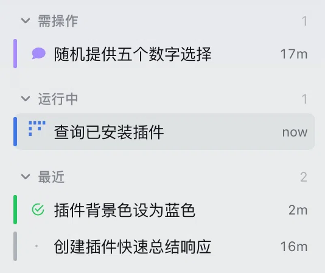

# DSH Workbench

English | [简体中文](README.zh-CN.md)

Personal productivity plugins for DeepSeek Harness (DSH): a live Session status
sidebar and on-demand response summaries.

> **Unofficial, independently maintained.** This is a personal plugin collection,
> not an official DeepSeek product or plugin bundle. It is not affiliated with or
> endorsed by DeepSeek.



Two independent plugins, maintained in one repository. No submodules; install
either bundle or both from their subdirectories.

| Bundle | What it does | Where it shows up |
|---|---|---|
| [`dsh-agent-board`](dsh-agent-board/README.md) | A live Session board modelled on the `agentbar` tmux sidebar | The left sidebar's browsing region, always visible |
| [`dsh-high-level`](dsh-high-level/README.md) | `/hl` summarizes one assistant reply into 3–5 bullets | A card under that turn, plus a summary button in the message action row |

## Install

Both are local-directory bundles. Nothing is published to a registry, so install
by pointing DSH at the directory.

**From the app.** Open **Plugins**, choose **Add plugin**, and pick the bundle
directory (for example `dsh-workbench/dsh-agent-board`).

**With the agent.** Ask DSH to install the bundle, or run the equivalent
`plugin_manager` call with `action: install_bundle` and the absolute directory
as `target`.

Then **quit and reopen DSH** for the first load. After that, edits apply through
HMR without a restart, because an installed local directory is linked rather
than copied.

To remove one, turn it off (or remove it) in **Plugins**.

## Requirements

- The DSH build these were written against: `0.2.2-rc.5`.
- No build step, no dependencies, no install scripts. Both halves are plain
  ESM (`index.js`) and a browser module (`client.js`).

## How a bundle is laid out

```
<name>/
  package.json        # name, exports, dsh.bundle.patch, dsh.client
  cordis.patch.yml    # the loader row this bundle inserts
  index.js            # Host half: exports apply(ctx) (and optional name/inject)
  client.js           # Browser half: registers slots via window.__ModuleLoader__
  locale/{en,zh}.json # Plugin Manager title, description, detail pointer
  icon.svg            # 36×36 icon for the plugin row
  README.md           # The page Plugin Manager falls back to
```

`dsh.client.inject` lists the client packages whose slots the browser half
fills; it orders activation only, it is not an import.

## Conventions used here

- **No imports from Harness packages.** The Host half reads Cordis services off
  `ctx`; the browser half uses the slot registry and the standard props the
  frame injects. A bundle therefore keeps loading across small DSH upgrades
  instead of breaking on a moved internal export.
- **Session state is read, never invented.** Both plugins consume values the
  page already holds (`useSessions`, `useSessionStatus`, the command lifecycle).
  Neither appends its own Session event type, so a Session log stays readable by
  an unmodified DSH.
- **Theme tokens only.** Every color, radius, and font step is a
  `--dsw-alias-*` or `--dsh-*` variable, so both plugins follow light/dark and
  the font-size setting.

## License

MIT. See [LICENSE](LICENSE).
