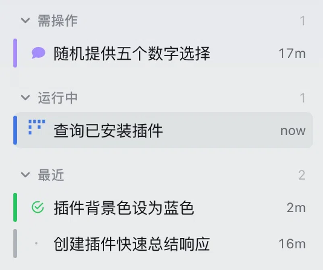

# DSH Workbench

[English](README.md) | 简体中文

为 DeepSeek Harness（DSH）补充日常使用体验的个人插件集合：常驻会话状态侧栏，以及按需生成的回答总结。

> **非官方、独立维护。** 本项目是个人维护的插件集合，不是 DeepSeek 官方产品或官方插件包，与 DeepSeek 没有隶属关系，也不代表获得官方认可。



一个仓库维护两个独立插件，不使用 submodule。可以只安装其中一个，也可以同时安装。

| 插件 | 用途 |
|---|---|
| [dsh-agent-board](dsh-agent-board/README.md) | 常驻左侧栏的会话状态列表：需操作、运行中、最近、睡眠 |
| [dsh-high-level](dsh-high-level/README.md) | 通过 `/hl` 或回答旁的操作按钮，总结指定的助手回复 |

插件详细说明目前为英文，本页提供中文的安装、验证与安全说明。

## 安装

克隆仓库后，在 DSH 中打开 **插件 → 添加插件**，选择要安装的插件子目录的绝对路径，**不要选择仓库根目录**：

- `dsh-workbench/dsh-agent-board`
- `dsh-workbench/dsh-high-level`

也可以让 DSH 智能体通过 `plugin_manager` 工具安装对应目录。

两个插件都**不依赖外部 npm 包**，软链接安装无需先执行 `pnpm install`。

**侧栏插件会替换原生工作区浏览区**，不保留该区域的搜索、工作区管理、拖拽排序和上下文菜单。禁用该插件即可恢复。

接口核对基于 **DSH 0.2.2-rc.5**。是否生效以插件管理器的 `application` 结果与重启提示为准：本地软链接不等于自动热更新；改动 Host 代码后可能需要完全退出并重开 DSH，改动 Client 代码后刷新当前 GUI 即可，不要另开 Web 服务器。

## 开发与测试

本地检查使用 Node.js 22+，无需编译、无运行时依赖：

```sh
npm run check
npm test
```

测试覆盖：会话状态判定与睡眠阈值、行数不截断、图标码位与字体加载、CSS 规则完整性、压缩后历史回答的选择、输入长度预算、模型路由变更、错误与取消处理。

这些是纯函数与 Host 契约测试，**不能证明浏览器中的实际外观**，也不能替代端到端模型调用。

## 数据与安全

- 两个插件都不保存 API key，也不读取 SSH 私钥。
- 侧栏插件从已有 Session 事件与列表数据推导状态，不读盘、不调用模型。
- `/hl` **只发送所选回答的可见正文及固定总结指令**。默认使用会话最近的模型路由；显式配置其他 `provider/id` 后，正文会发送到指定提供商。这是额外一次模型请求，不是本地总结。
- 两个插件都不自创 Session 事件类型，也不建立第二份会话目录。

## 仓库约定

保持两个插件目录各自完整，运行时文件必须列入对应插件的 manifest。日常修复使用新提交，不随意重写已有历史或强制推送。

保留现有 [LICENSE](LICENSE) 文本。删除版权人署名行本身，不代表放弃版权或署名权。
