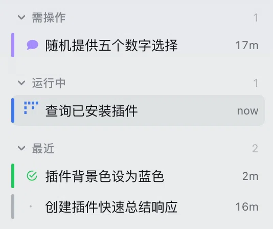

# dsh-agent-board

A live Session board that occupies the sidebar's browsing region, modelled on
the local `agentbar` tmux sidebar: four sections, one compact row per Session
with a status glyph, the title, and how long ago it changed. Selecting a row
opens that Session.



*Purple bubble = needs you, blue dot grid = running, green check = turn finished,
grey dot = idle. The state-colored bar down each row is the one trait borrowed
from agentbar; the rest of the row keeps the host list look.*

## Where it appears

It fills `sidebar.workspaces` — the whole region between the panel rows and the
footer — so it is **always visible**, not a page you open. There is no extra
sidebar entry and no main-column page.

**Enabling it replaces the shipped workspace browser**, which also removes its
search box, drag reordering, and workspace grouping controls. Disable the plugin
to get that browser back.

Because the seat is `single` and the board is its only occupant, the board also
restates the browser's child-slot table (`sidebar.workspaces.directoryFlow` and
the four Session-row seats). Those child seats exist only while the occupying
entry declares them: without the restatement the directory-picker clients wait
forever on a seat nobody declared, and every picking affordance disappears —
the "Add workspace" row in the shipped picker menu included. If you edit that
table, keep it identical to
`@deepseek-ai/dsh-client-ui-workspace`'s own `register` call: a key or kind
drift either strands a client or fails the registration outright.

The **Add-workspace** control is the one browser action the board keeps: a ＋ in
its header strip (also present when the sidebar is folded to its rail) that
raises the shipped `workspace.picker` Factory. That Factory owns the choice and
the registration, so the board works with whichever directory backend the Host
resolved at boot — the native OS chooser or the in-app browse dialog. The board
deliberately does not call `uiWorkspace.pickDirectory()`: that verb needs the
`native` capability and refuses with `directory-picker/unavailable` on a Host
serving `browse` (remote authority, SSH, non-loopback bind). Without the Factory
in the composition, the ＋ is hidden rather than dead. Everything else about
managing Workspaces (search, reordering, grouping) is still the browser's.

## The board

| Section | Membership |
|---|---|
| Needs you | The Session has a pending interaction (approval, question, plan review) |
| Running | The Session has live work |
| Recent | Quiet Sessions updated within the last 12 hours, newest first — a Session whose turn finished shows a green check here |
| Sleeping | Quiet Sessions with no update for 12 hours or more — **folded by default**, so it costs one header until you open it |

The four sections are evaluated in that order, so **state outranks age**: an
approval left pending for two days stays in *Needs you*, and a long-running turn
stays in *Running*. Only a Session with nothing pending and no live work can
fall asleep, and age is checked before the finished/idle split — so a Session
that finished 13 hours ago is *Sleeping*, not *Recent*.

**Sleeping starts folded.** The other three sections start expanded, and every
section remembers its state for the lifetime of the panel.

An expanded section renders **every** row it holds; the header count and the
list agree. There is no row cap and no "show more" control — the sidebar hands
the seat one scrolling viewport, so a cap would only make later rows
unreachable, and *Needs you* is exactly where hiding a row costs the most.

| Element | Source |
|---|---|
| Row tint | The whole strip takes the state color at low alpha, so a colored row is readable across the sidebar |
| Glyph | Needs you: comment bubble (violet). Running: dot grid / braille spinner (blue). Finished turn: circled check (green). Idle: `·`, sleeping: `○` (grey). Nerd Font icons fall back to `?` / `✓` / `○` when no local face loads |
| Title | The Session's display title |
| Time | Compact age of the last change (`3m`, `5h`, `3d`) |

Each section collapses independently and starts expanded. Blank Sessions and
subagent children are omitted. When the sidebar collapses to its 56px rail the
board degrades to one dot per active state, so a pending approval still shows.

## What it reads

`useSessions` (the Session list) and `useSessionStatus` (live running and
pending-interaction state), both already supplied to the seat. No Session is
opened or retained to draw a row, no log is read, and no model request is made.

## Glyphs

The glyphs are the ones `agentbar` uses, taken from its sidebar renderer:

| State | Glyph | Code point | Needs a Nerd Font |
|---|---|---|---|
| Running | braille spinner `` ⠋⠙ `` cycling through 10 frames | U+280B… | No — ordinary Unicode |
| Needs you | `` (nf-fa-comment) | U+F075 | Yes |
| Done | `󰄴` (nf-md-check_circle) | U+F0134 | Yes |
| Sleeping | `󰒲` (nf-md-sleep) | U+F04B2 | Yes |
| Idle | `·` | U+00B7 | No |

The spinner advances through those 10 frames on a 100 ms timer, the same
cadence agentbar redraws at. It is driven by JavaScript, not CSS: `content` is
not an animatable property in any current engine, so a `@keyframes` sequence
over it renders the first frame and then stops. Each frame carries two braille
cells so the glyph keeps an even width and the title beside it never nudges
sideways. Braille is ordinary Unicode, so the spinner runs without a Nerd Font;
a reader who asks for reduced motion keeps the first frame held still.

The three Private Use Area glyphs render only when a Nerd Font is installed. The
board **measures** whether they paint rather than trusting a family name: a
missing glyph falls back to a box that is wider than two Latin characters, so a
canvas measurement distinguishes the two. Without a Nerd Font the board falls
back to `?`, `✓`, and `○`, which are the shapes it used before — no tofu boxes.

Nerd Font families are listed in `--dshAb-nerd` on the board root. Add your own
family there if the probe misses it.

## Colors

The palette is taken from `agentbar/ui.py` (`LABELS` plus its curses color
pairs), not from an amber/green traffic-light reading:

| State | agentbar | Here |
|---|---|---|
| Running | cyan (`palette.info`) | the business accent (blue) — the DSH palette ships no cyan |
| Needs you | magenta (`palette.accent`) | violet (`--dsw-static-violet-400`) |
| Done | green (`palette.success`) | green |
| Idle | dimmed | gray |
| Sleeping | dimmed + sleep glyph | the same gray, painted fainter |

All of it lives in `COLORS` at the top of `client.js`:

```js
const COLORS = {
  attention: 'var(--dsw-static-violet-400)',
  running:   'var(--dsw-alias-state-business-primary)',
  done:      'var(--dsw-alias-state-success-primary)',
  idle:      'var(--dsw-alias-label-caption)',
  sleeping:  'var(--dsw-alias-label-caption)',
}
```

Everything except `attention` is a theme alias, so it follows light/dark and
brand overrides. `attention` names a static step because the theme has no violet
alias; it clears AA contrast on both sidebar backgrounds.

Rows do **not** paint a full-width wash: the state color appears in the leading
bar and in the glyph only, so the row keeps the host's own background and
hover/selection behavior.

### How "done" is decided

DSH raises `completionUnread` when a Session it observed running stops, and only
while that Session sits **outside the main view**. That is the board's only
completion evidence.

A title is deliberately *not* treated as completion: DSH projects a title as
soon as the first user message commits, so a turn that failed or was interrupted
still carries one, and reading it as "done" painted failed Sessions green. The
conversation you are looking at has no completion marker at all and stays idle
or running rather than being guessed at.

Sleep age is checked **after** the completion test, so a turn that ran past the
12-hour threshold does not drop into *Sleeping* the moment it lands.

## Changing the sleep threshold

`sleeping` is one constant in `client.js`:

```js
const SLEEP_AFTER_MS = 12 * 60 * 60 * 1000
```

Raise it to keep more history in *Recent*, lower it to clear the panel sooner.
Because the board reuses the Session's `updatedAt`, any prompt, steer, or turn
end resets that Session's clock — there is no separate "wake" action.

## Limits

- **The workspace browser is gone while this is on.** That is the trade: the
  seat is single-occupancy, so both cannot share it.
- **Row order is fixed** by section and recency; there is no manual reordering.
- **Sleep is purely a time threshold.** A Session you are actively reading but
  have not prompted does not count as activity, so it can sleep 12 hours after
  its last turn even if you keep opening it.
- **`?` is generic.** Three shipped interaction kinds get their own tooltip
  sentence; any other kind falls back to the generic attention label.
