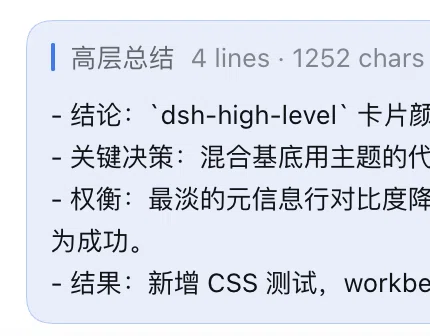

# dsh-high-level

Append a high-level summary card after an assistant reply you designate, without
rewriting that reply and without adding anything to the agent's context.

This is the DeepSeek Harness port of the local `pi-high-level` extension: the
same idea (box one finished answer into a few bullets), built on DSH's own
command lifecycle instead of a custom Session entry.

It is one package with two halves: a Host plugin that runs `/hl` and calls the
model, and a browser plugin that renders the result as a card. Neither half
imports a Harness package — the Host uses Cordis services, the browser uses the
slot system — so it loads in any composed profile.

## Use it

Three ways to trigger one summary:

| Trigger | What it does |
|---|---|
| The summary icon in a finished message's action row | Summarizes exactly that message |
| `/hl` in the composer | Summarizes the latest assistant reply in this Session |
| `/hl <n>` | Summarizes the n-th latest reply (`/hl 2` is one back) |
| `/hl #<messageId>` | Summarizes one specific message |
| `/hl status` | Shows the model, timeout, and output budget in use |
| `/hl model <auto\|current\|provider/id>` | Changes the summary route and saves it in the profile patch |

The result is a normal `command/run` + `command/done` pair, so the card appears
below the turn it describes, survives a reload, and renders as a collapsed
panel: five lines, a click to expand, and the route, source length, and elapsed
time in the header. While the request runs the card shows a shimmer and a
running clock. Short replies are refused instead of summarized, and that
refusal is reported next to the icon you clicked.

`/hl status` and `/hl model` answers render in the same panel with a neutral
`/hl result` title, so they are never confused with a summary.

## Looks



The card is tinted with the harness business blue (`--dsw-alias-state-business-primary`),
mixed 9% into the theme's code-block surface, so it reads as its own panel beside
the transcript without becoming a banner. The fill mixes into a theme surface
token rather than `transparent`, so it stays opaque over anything that scrolls
behind it, and both light and dark palettes derive their own weight from the
same rule. A failed summary drops the tint and keeps the neutral surface, so the
red body stays the only signal.

The tint is one variable, `--dshHl-accent`. Unset, it takes the business accent;
a theme or a host page may define it on any ancestor to recolor the card, and
`--dshHl-surface` / `--dshHl-edge` override the fill and border directly:

```css
/* a stronger blue, scoped to one page or one theme */
.dshHl_card { --dshHl-accent: var(--dsw-static-deepseek-400); }
```

To set it from somewhere other than the page, put the declaration in any
stylesheet that reaches the card — a theme that ships CSS, a profile-level
style, or a second tiny bundle that only injects a `<style>`. The card reads the
variable off its own element, so nothing here needs editing.

Small header text stays at 4.98:1 on the tinted fill in light mode (9.8:1 in
dark) and body text far above both, so the panel needs no separate text color.
The one step that sits below AA is the tertiary meta line (3.18:1, from 3.55:1
on the neutral fill): it is de-emphasized metadata by design, and the tint costs
it about a tenth of its contrast.

## What it costs and what it touches

- Each card is one extra model request on the route the Session already uses,
  capped at `maxOutputTokens` (400 by default) and `timeoutMs` (30 s).
- That request carries the reply's text (clipped around the middle at
  `maxInputChars`, 16 000 by default), so the text reaches the same provider the
  conversation already uses.
- The summary is recorded as a log-only command result: it never enters the
  model's context, and turning the bundle off leaves existing cards readable.

## Configuration

Optional fields on the `high-level` row in the profile patch:

| Field | Default | Meaning |
|---|---|---|
| `model` | *(session route)* | `provider/id`, a bare model id, or empty for the Session's route |
| `timeoutMs` | `30000` | Total budget for one summary request |
| `maxOutputTokens` | `400` | Output cap for the summary |
| `maxInputChars` | `16000` | Reply text sent to the model, clipped in the middle |
| `minReplyChars` | `160` | Below this, a reply counts as already brief |
| `minReplyLines` | `4` | … unless it also has this many non-empty lines |

## Limits

- The card is a command row, not an inline annotation: it sits after the turn
  tail, not glued to the message bubble.
- Summarizing a message from an earlier turn still appends the card at the end
  of the Session, because that is where the log records the command.
- A Session with no recorded request yet has no route to borrow; set
  `model` explicitly in that case.
